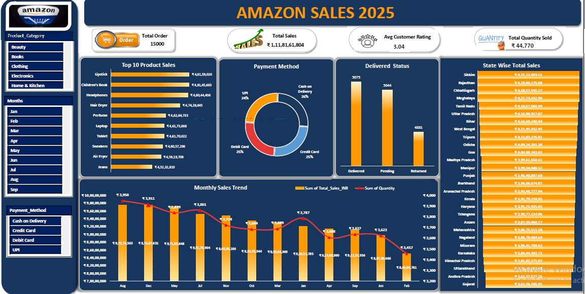

# Amazon Sales Analysis Dashboard (2025)

## Project Overview
This project presents an interactive Amazon Sales Analysis Dashboard created using Microsoft Excel.

## Dashboard Features
- Total Orders
- Total Sales
- Average Customer Rating
- Total Quantity Sold
- Top 10 Product Sales
- Payment Method Analysis
- Delivery Status Analysis
- State-wise Sales Analysis
- Monthly Sales Trend

## Tools Used
- Microsoft Excel
- Pivot Tables
- Pivot Charts
- Slicers
- Data Visualization

## Project Files
- Amazon_Sales_Analysis_2025.xlsx
- Amazon_Sales_Dashboard.png

## Dashboard Preview

## Project Objective
To analyze Amazon sales data and present meaningful business insights through an interactive Excel dashboard.

## Created By
Kalpesh Gosavi
